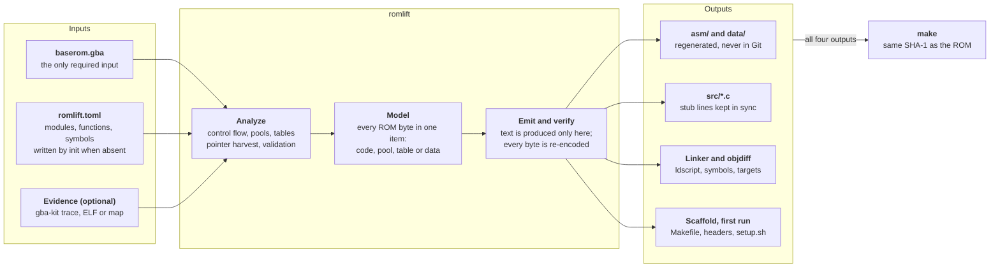
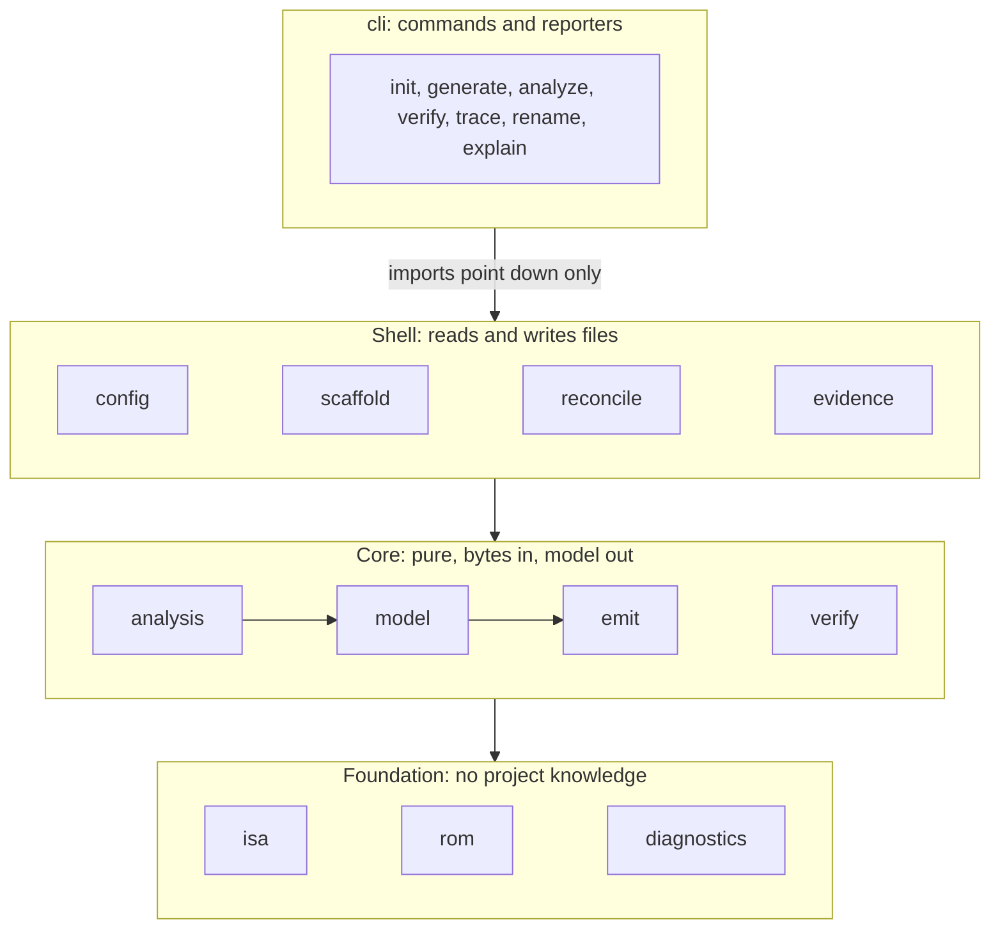
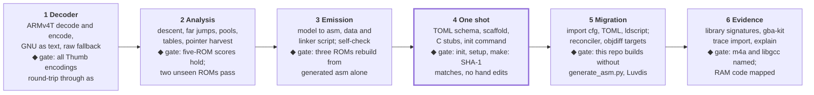

# GBA decomp scaffolder — detailed plan

> Exported from the Plan tab of the Claude Docs artifact <https://claude.ai/code/artifact/7963dcce-e818-490a-a959-ca96941bdc23> (revision 26, 2026-10-17). The three embedded diagrams are transcribed as Mermaid from their SVG source. "This repo" in the text means the Klonoa decomp repository (klonoa-empire-of-dreams), where the plan was written.

Oct 16, 2026 · @Bruno

The plan is a standalone Node.js/TypeScript CLI that reads a GBA ROM and, in one run, writes a buildable matching-decompilation project: a TOML config, regenerated `.s` files and `.c` stubs. It generalizes `scripts/generate_asm.py` and carries its own analysis and ARM/Thumb disassembler, with no Luvdis or Ghidra dependency. A TypeScript proof of concept of the analysis, judged by five matching ELFs, finds every compiled function entry: the 14 symbols it still misses are labels the decomps typed as functions. Its scaffold rebuilds all five ROMs byte-for-byte from raw-byte .s files, so the tiling, linker script and build loop are proven; the instruction printer is the main piece left. gba-kit fits as an optional evidence pass rather than a dependency.

## At a glance

**One model of the ROM sits between analysis and every output file** (diagram: romlift pipeline, 3 inputs, 3 stages, 4 outputs)



The ROM and the TOML are the only inputs that matter. Every output is derived from one in-memory model, so generated files can be deleted at any time and rebuilt on the next run.

## What exists today

Neither Luvdis nor gbadisasm follows function pointers or scaffolds a project. That gap is why this repo needed Ghidra and 3,000 lines of repair script.

|  | Luvdis 0.8.0 | gbadisasm | This repo's pipeline | romlift |
| --- | --- | --- | --- | --- |
| Built with | Python | C, Capstone 3.0.5 vendored | Python over Luvdis, plus Ghidra for two inputs | TypeScript, no native code |
| Instruction sets | Thumb | ARM and Thumb | Thumb; ARM is hand-written | ARM and Thumb |
| Functions found here with no config | 93 | 1 | None: needs a 662-entry list | 559 of the 562 in kleod's ELF; the 3 left are labels (proof of concept) |
| `bl` as a far jump | Always a call | Guessed from a pool or zero halfword after it | Three hard-coded addresses and merge heuristics | Decided from control flow |
| Functions reached by pointer | No | Only `ldr` directly followed by `bx` | From the list | Harvested, then validated |
| Function end | Not computed | Bytes swept | Text heuristics | From control flow |
| Jump tables | None | Thumb only, fixed pattern | None | Register tracking |
| End of code | `--stop` option | Stops printing at the last label | Constant in the script | Derived |
| Thumb halfwords that do not survive `as` | 50 of 65,536 | 1,226 of 65,536 | As Luvdis | Each falls back to raw bytes |
| Project scaffold | No | No | This repo only | Yes |
| Time on this ROM | 6.8 s | 2.4 s, jzw fork | Luvdis plus repair passes | About 1 s (proof of concept, TypeScript) |

Three notes on the numbers. The 93 is from the technical report; with this repo's list Luvdis adds 3 functions of its own. gbadisasm finds 22 functions when given only `AgbMain`, and upstream aborts on this repo's full list; the jiangzhengwenjz fork completes. Both disassemblers produce byte-exact output on compiler-generated code, so the round-trip failures concern unusual encodings.

Each existing tool contributes something the plan keeps:

- **Luvdis:** one cursor that emits every byte exactly once, a raw fallback for encodings `as` will not reproduce, and the macro and label conventions this ecosystem already reads.
- **gbadisasm:** typed labels with a worklist, analysis kept apart from printing, and seeds from interworking sequences. The jiangzhengwenjz fork adds user directives for labels, far jumps, pools and tables, which become `[[overrides]]`.
- **This repo:** `INCLUDE_ASM` stubs, the `matchings` and `nonmatchings` split, names kept in a TOML, and assemble-and-compare as a safety net.

Source-level notes on each tool are in the Research notes tab.

## What the current pipeline taught us

Forty-two commits to `generate_asm.py` since March, counting every branch, trace back to six root causes, and each one becomes a rule for the new tool. Commit hashes are from this repository.

| Root cause | Evidence here | Rule for the new tool |
| --- | --- | --- |
| The generator repairs text instead of modelling bytes | It finds addresses by counting bytes per listing line, so a ±2 drift needs a scoring pass to detect. One pool rewrite moved 2.9 MB of ROM on its first attempt (`c9340c7`). 553 of its 2,996 lines are abandoned variants of the same fix. | One address-indexed model of the ROM. Text exists only at emission. |
| `bl` is assumed to be a call | agbcc also emits `bl` as a far jump inside large functions. 105 of the 662 `functions_merged.cfg` entries sit at 2-mod-4 addresses. One 28,652-byte function holds 27 entries, 20 of them `bl` targets (`eed890c`). | Classify every `bl` as call or far jump from control flow. |
| The function list was never validated | It was merged from Ghidra and Luvdis outside the repo. 42 entries pointed at data (`cb86fb9`), one sat inside a literal-pool word (`ef51a03`), and 711 entries became 662. | Check every entry, found or given, against the model. A failed check is a diagnostic. |
| Functions reached only by pointer were not seeded | 143 of 710 functions had no direct `bl` (`docs/pointer-table-analysis.md`). Luvdis alone found 93 functions; Ghidra added about 300. | Harvest pointers from pools and data, then validate each by decoding it. |
| Code and data are told apart by guesswork | `CODE_END` is hard-coded to `0x08052000`, but read-only data starts at `0x08051BD4`. The 660 Ghidra `data_regions` in the TOML are read only as an on/off flag. The output still has 1,630 branches as `.2byte`, 1,858 loads as `.inst.n` and 72 calls as `.4byte`. | Code is what control flow reaches. Every branch, load and call is symbolic. |
| State lives in five hand-synced files and in the script | The cfg, the TOML, `INCLUDE_ASM` lines, 487 absolute symbols in `ldscript.in.txt` and `asm/thumb_aliases.s` must agree. The script holds 17 hard-coded ROM addresses. | One TOML. No ROM-specific constant in code. |

Three further lessons shape the design:

- Verification came late and found real holes. 1,454 ROM bytes sat in no `.s` file while every check passed (`6be0678`).
- The generator read and rewrote C sources, so a clean build could fail (`c9c6bcc`) and renames by string replacement changed prose. Assembly output must depend only on the ROM and the TOML.
- There is no ARM path. `asm/crt0.s` is hand-written and `asm/m4a0.s` was borrowed from kleod.

The technical report sets the remaining goals: no ROM-derived assembly in Git, a paved path for the next GBA game, `INCLUDE_ASM` stubs in splat style, and a layout an AI agent can work in from a fresh worktree.

## Requirements and non-goals

The acceptance test has two parts. `npx romlift init baserom.gba && ./setup.sh && make` must end with the ROM's SHA-1, with no file edited by hand. The split it produced must also meet the function-entry scores under Verification, because a single `.incbin` would pass the first part. `romlift` is a working name; alternatives are under Name suggestions.

| # | Requirement | How it is checked |
| --- | --- | --- |
| R1 | One shot: a ROM in, a buildable project out, split into functions | End-to-end test on five ROMs: the SHA-1, plus the split scores |
| R2 | Standalone: Node 22+ and TypeScript, no Luvdis, Ghidra, Python or Capstone | Runtime dependencies are npm packages only |
| R3 | One TOML holds every setting and decision; `init` writes it when absent | `generate` never writes the TOML |
| R4 | `.s` files are regenerated on every run and gitignored | Two runs give byte-identical trees |
| R5 | Output is byte-exact. Every run self-checks it, and the build proves it | Built-in re-encode and coverage check, then the SHA-1 after `make` |
| R6 | No ROM-specific constant in tool code | Every benchmark ROM runs with zero code changes |
| R7 | Clean architecture: a pure core, small modules, typed boundaries | Lint-enforced layer rules, unit tests per module |
| R8 | Agent-friendly: no prompts, JSON diagnostics, an `explain` command, worktree-safe | Runs in a fresh `git worktree` without the main checkout |
| R9 | `generate` never rewrites user C code, apart from `INCLUDE_ASM` lines. Only the explicit `rename` command edits identifiers | Reconciler test suite |

Not in the first release:

- Decompiling to C. That stays with asmlift and the matching loop.
- Typed assets. Data is emitted as labelled `.incbin` slices and pointer tables, not as graphics or maps.
- Compilers other than agbcc. The compiler rules sit behind a profile interface, and only the agbcc profile ships.
- Shiftable builds, other consoles, and a GUI.

## Architecture

The tool is one npm package in four layers, and imports only point downward. Files are touched in one layer, so the core can be tested on bytes held in memory.

**Files are touched only in the shell layer; the core is pure** (diagram: romlift layers, 4 layers, 12 modules; imports point down only)



| Module | Owns |
| --- | --- |
| `rom` | ROM bytes, the cartridge header, the GBA memory map |
| `isa` | One ARMv4T instruction table that drives decoding, encoding and GNU `as` text, for ARM and Thumb |
| `diagnostics` | Typed warnings and errors with addresses, printed as text or JSON |
| `analysis` | The passes of the analysis engine and the compiler profile |
| `model` | The tiling, functions, symbols, references and modules, with the evidence behind each fact |
| `emit` | Assembly, data, linker and objdiff text, as an in-memory file tree |
| `verify` | Tiling, re-encode and size checks |
| `config` | The TOML schema, validation, generation and comment-preserving patches |
| `scaffold` | Templates for the files written once |
| `reconcile` | `INCLUDE_ASM` lines in C files, through a tokenizer rather than regexes |
| `evidence` | Importers for gba-kit traces, ELF and map files, and the legacy cfg |
| `cli` | Commands, and the human and JSON reporters |

Four rules keep it from growing back into one large script:

- **Each pass is a small module.** It declares what it reads from the model and what it adds. Only the fixpoint loop knows the order.
- **Every fact records its origin.** `romlift explain 0x0800D81A` prints which pass decided what, from which bytes. That is the answer an agent needs when it doubts a boundary.
- **The model is a public API.** `romlift model --json` and the library export let asmlift or Mizuchi read functions and symbols without parsing `.s` files.
- **Layer rules are linted.** The core cannot import the file system, and the build fails if it tries.

The toolchain is TypeScript in strict mode, with a unit-test suite per module and property tests for the encoder. Runtime dependencies stay at a TOML library and little else.

## Analysis engine

Functions come from control flow over the ROM's bytes, under rules read from agbcc's own code generator and from the shapes hand-written code takes. A TypeScript proof of concept of these rules (`romlift-poc`, see the Prototype tab), judged by the function symbols of five matching ELFs, reaches 100% recall on three ROMs and 99.5% to 99.9% on the other two, where every remaining miss is a label rather than a function start.

The passes run in this order, and repeat until nothing new is found:

1. **Seed.** Follow the ARM branch at `0x08000000` through the startup code. Add every function the TOML lists and every hint from evidence files.
2. **Descend.** Decode each function from its entry, following branches and tracking ARM or Thumb state. A call from accepted code adds a trusted entry.
3. **Harvest pointers.** A word with the Thumb bit that points at an aligned ROM address is a candidate. Literal pools of accepted code are searched first, then every aligned word in the ROM.
4. **Validate and weigh evidence.** A candidate is accepted only when it passes both tests in the table below.
5. **Scan gaps.** Free bytes between two accepted runs are tried as unreferenced functions, chained from both ends of the gap.
6. **Classify the rest.** Zero halfwords before an aligned address are padding. Everything else is data.

| Rule | Why it holds | What it prevents or recovers |
| --- | --- | --- |
| A `bl` is a call when its target is an accepted function, lies before the caller's entry, or is closer than 1,536 bytes | `thumb.md` uses `bl` as a jump only beyond the range of `b`. The shortest far jump in five ROMs spans 1,960 bytes | Calls to local subroutines in hand-written code read as jumps |
| Otherwise a `bl` is a far jump when its target lies inside the caller, or when the target's return path pops a frame it never pushed | A callee is never inside its caller, and `thumb.c` uses far jumps only in functions that pushed `lr` | Functions split at a branch target |
| A call followed by non-code never returns; a `swi` followed by non-code, and a `mov pc, rN` with no table, end the function | agbcc emits no epilogue after such a call; BIOS resets and register callbacks | A literal pool decoded as instructions; `SoftReset` and the functions that call it |
| A branch into another function leaves the current one and counts as a return | A function is one contiguous run; hand-written code shares tails | `ply_rept`, `MP2K_event_patt`, ARM routines that share a loop |
| A literal-pool word is whatever a PC-relative load reads; the extent is the code plus adjacent pools, and far pools are claimed but not part of it | It is the meaning of the instruction; hand-written code loads pools hundreds of bytes away | Shape guesses; `m4aSoundVSync` |
| A jump table is found by tracking which register reaches `mov pc` | The compiler may hoist other work between the table read and the jump | A fixed look-behind window that misses tables |
| Validity: a candidate decodes without error, returns with a balanced stack, touches no claimed byte, fills its extent (zero padding before a pool counts), is not a run of Thumb code pointers, and calls nothing that is clearly not code | A compiled function is dense and leaves the stack as it found it; pointer tables decode as Thumb pairs | Data that happens to look like a pointer, and pointer tables accepted as code |
| Evidence: a valid candidate starts where accepted bytes end; failing that, it opens with `push {.., lr}` and is loaded by accepted code or ends where an accepted function starts; failing that, its pointer sits in a run of three or more Thumb pointers to valid targets | Compiled code is a dense tiling; only an entry has that prologue; leaf handlers are referenced only from a table | Bogus functions in data; the m4a `ply_*` handlers |
| A tiny unreferenced candidate must be anchored at its start and not open with a branch | `bx lr` stubs are real functions; `b` fragments after a jump table are not | 2-byte false entries |
| Tiled hole: the reading of a gap's first bytes that ends where the next function starts is accepted even when it is not dense or its stack is unbalanced, and the gap waits for that anchor before anything else is taken from it | Hand-written mixers keep ARM blocks and tables inside a Thumb function | `SoundMainRAM` on all five ROMs |
| ARM gap scan: an ARM function opens with an unconditional non-branch instruction, may keep pool words and a table it refers to in front of it, may keep internal holes when it fills its gap, and is preferred over a prologue-less Thumb reading of the same bytes | Hand-written ARM keeps pools before the code and dispatches through branch tables; pool words decode as Thumb pairs | Heap, OAM and map routines; 14-byte Thumb stubs in front of ARM functions |
| `bx pc` switches to ARM at the next word | It is the linker's Thumb-to-ARM veneer | ARM thunks printed as raw halfwords |
| Candidate readings are recomputed each round | A reading goes stale as neighbours get accepted | A function's end anchor missed because an older reading ran past it |

The compiler-specific rules live in a profile object: the far-jump form, the table-jump idiom and the prologue shape. Only the agbcc profile ships at first.

Proof-of-concept scores with no configuration, each ROM judged by the ELF that rebuilds it (checkouts: kleod, sa2 `393357f7c`, sa3 `59df6083`, FireEmblem7J `f27a029`, pokeemerald `731ad5bfd`):

| ROM | ELF functions | Precision | Recall | False | Missed | Sizes equal | Time |
| --- | --- | --- | --- | --- | --- | --- | --- |
| Klonoa: Empire of Dreams | 559 | 99.82% | 99.46% | 1 | 3 | 485 of 485 | 0.9 s |
| Sonic Advance 2 | 2,892 | 99.79% | 100.00% | 6 | 0 | 2,886 of 2,889 | 1.3 s |
| Sonic Advance 3 | 4,693 | 99.87% | 100.00% | 6 | 0 | 4,304 of 4,307 | 19 s |
| Fire Emblem 7 (Japan) | 7,735 | 99.86% | 99.86% | 11 | 11 | 1,471 of 1,471 | 11 s |
| Pokémon Emerald | 15,856 | 99.96% | 100.00% | 6 | 0 | 15,849 of 15,853 | 7 s |

"Sizes equal" compares the recovered extent with the ELF size, for found functions that have one: 24,994 of 25,005. The derived end of code matches the ELF in all five ROMs. The sa3 and FE7J times come from the gap walker waiting for anchors over several passes; nothing is optimised.

The 14 remaining misses are not function starts. All lie inside a function the tool found, and the bytes agree: Klonoa's three are kleod's names for offsets inside `SoundMainRAM`, whose 932-byte extent sa2, sa3 and Emerald give it without typing those offsets as functions; FE7J's eleven begin right after a `bl` whose callee never returns, or at a loop's `bne`, and read registers set by the code before them. Reaching them would mean declaring a new function after every call, which splits real functions everywhere else.

The 48 false entries are mostly code the ELFs do not type as functions: the ROM entry, startup code, interrupt entries and linker veneers (2 to 4 per ROM); the sound engine's `bx r3` thunks reached by `bl`, and the ARM mixing loops inside `SoundMainRAM`, which the ELFs fold into their parent; Emerald's six multiboot handlers reached through `adr`. One or two genuine mistakes remain per ROM, all under 50 bytes.

On Klonoa the same ELF also judges the curated list. Of the 662 `functions_merged.cfg` entries, 283 are not functions in kleod's ELF, and 282 of those lie inside a function the prototype found. The list also lacks 183 functions that the ELF has.

Three limits apply:

- **These are not held-out scores.** The rules were fixed against these five ROMs, twice: once after an independent review of the first draft, and once in the proof of concept to reach the numbers above. Phase 2 must add ROMs they have never seen.
- **Entries, extents and tiling only.** The proof of concept emits every function as raw bytes, so byte-exact output is proven for the layout but not for a single printed instruction.
- **One compiler.** All five ROMs were built with agbcc.

## Emission

The model is a tiling of the ROM, so output is byte-exact by construction. Each run self-checks that before a file is written, and the SHA-1 after `make` is the proof.

The proof of concept already runs this loop in its raw form: every function chunk is emitted as `.2byte` and `.4byte` data under a `thumb_func_start` or `arm_func_start` label, the bytes between functions as `unk_XXXXXXXX` chunks, and the rest as one `.incbin`. All five ROMs rebuild byte-for-byte with `arm-none-eabi-as`, `ld` and `objcopy` alone. The match is by construction, so it proves the tiling and the linker script, not the printer.

- **Tiling.** Every ROM byte belongs to exactly one item: an instruction, a pool word, a jump-table entry, padding or a data slice. Each item keeps its original bytes.
- **Instructions.** They are printed in GNU `as` unified syntax. A mnemonic is printed only when the built-in encoder turns that text back into the same bytes. Otherwise the item is printed as `.inst.n` with the decoding in a comment.
- **Labels.** Every branch target, pool word and table gets a label, so no branch or load is left as raw data. A label referenced from another module is declared `.global` automatically.
- **Addresses as symbols.** A pool or data word is printed by name only when the linker would produce the same value. A Thumb function name stands for its address plus one, so `.4byte AgbMain` is used for the odd word and a number for an even one. objdiff can then pair pool rows by name, which today needs `scripts/pool_abs_syms.sh`.
- **Padding.** Zero padding is printed as `.align 2, 0`. Pools stay aligned while a neighbouring C function is the wrong size, so loads never need raw encodings.
- **No orphan bytes.** Bytes in a C module that belong to no function, such as a table between functions or unreferenced code, get their own file and their own stub line. They are never attached to a neighbour, which is how 1,454 bytes went missing here. The one exception is alignment padding, which is not lost when it moves: the zero bytes `.align 2, 0` emits before a word-aligned function belong to that function, whose start macro emits them, and the zeros that align a module's end belong to the code before them (owner's answer to phase-3 Q5 b; decisions D68 e and D75 d), except after a function of a `c` module: there gas ends the decompiled function's C object with a nop, so the pad keeps its own file and stub line (D78 b; 11 on the tuning ROMs, kept by the owner's answer to phase-4 Q8, D79 a).
- **Second entries.** All six entries in `asm/thumb_aliases.s` turn out to be ordinary functions: each opens with `push {..., lr}` and has a direct caller. A true second entry occurs only in hand-written code, and is emitted as a typed global label in the parent's file.

| Output | Path | Unit |
| --- | --- | --- |
| Function not yet decompiled | `asm/nonmatchings/<module>/<Name>.s` | One function with its pools |
| Function already in C, kept as reference | `asm/matchings/<module>/<Name>.s` | One function with its pools |
| Bytes in a C module outside any function | `asm/nonmatchings/<module>/<label>.s` | One run of bytes |
| Hand-written or library module | `asm/<module>.s` | Whole module |
| Data | `data/<module>.s` | Labels, `.incbin` slices, pointer tables |
| objdiff target | `expected/<module>.s` | Whole module at exact offsets |
| Linker inputs | `ldscript.txt`, `symbols.ld` | From the TOML's modules and symbols |

The text of every file depends only on the ROM and the TOML. The C sources decide one thing: whether a function's file lands in `matchings` or `nonmatchings`.

Emission builds the whole file tree in memory, then writes only the files that changed. A manifest records which files the tool owns, so stale ones are removed and `make` stays incremental.

Each run self-checks three things: the items tile the ROM with no gap or overlap, every instruction re-encodes to its bytes, and each module's files add up to its address range. These checks cover encodings and layout. Symbol values, alignment and linking are proven only by the build, which is why `make` ends with the SHA-1. `romlift verify --assemble` runs that assemble-and-compare step per module without a full build.

## The TOML file

One file, `romlift.toml`, holds every decision. `init` writes it, `generate` only reads it, and `analyze --update` proposes changes as a patch that keeps comments.

```toml
schema = 1

[rom]
path = "baserom.gba"
sha1 = "a0a298d9dba1ba15d04a42fc2eb35893d1a9569b"

[build]
name = "klonoa-eod"
compiler = "agbcc"          # picks the analysis profile and the Makefile rules

[[modules]]                 # in link order; start addresses must increase
name = "crt0"
start = 0x080000C0
kind = "asm"                # emitted and assembled as one file

[[modules]]
name = "system"
start = 0x0800043C
kind = "c"                  # src/system.c with INCLUDE_ASM stubs

[[modules]]
name = "data"
start = 0x08051BD4
kind = "data"

[functions]                 # address = name; keys are 0x plus eight upper-case hex digits
0x08000470 = "AgbMain"
0x080000FC = { name = "IntrMain", mode = "arm" }
0x0804D074 = "ProcessButtonWait"

[symbols]                   # data and RAM
0x03005220 = "gUnk_03005220"
0x03002920 = { name = "gEntityInfo", aliases = ["gUnk_03002920"] }
0x08189E84 = { name = "gSpriteDataTable", type = "pointers" }

[[overrides]]               # facts analysis cannot infer; each is validated
start = 0x0804F318          # sound mixer, copied to RAM before it runs
size = 0x400
runs_at = 0x03000388
```

Five rules keep the file stable:

- **The address is the identity.** The name is an attribute, so a rename edits one string. The `sub_X = "Name"` table and the linker aliases it needs both go away. An address with several names lists the others under `aliases`.
- **Keys have one spelling.** TOML treats these keys as strings, so `0x08000470` and `0x8000470` would be two entries. The loader rejects any key that is not `0x` plus eight upper-case hex digits, and any address listed twice.
- **Every function entry is listed**, including those still named `sub_08001234`. A tool upgrade then cannot add or drop an entry silently. Ends and pool ownership are still computed, so the scaffold pins the tool version in `package.json`.
- **Discovery still runs on every `generate`, but only to report.** It flags listed entries that fail validation and code that looks like an unlisted function.
- **Overrides replace constants in code.** What `generate_asm.py` hard-codes today, such as `CODE_END` and the m4a range, becomes validated data.

| Command | TOML | Generated files | `src/*.c` |
| --- | --- | --- | --- |
| `romlift init <rom>` | Creates it | Writes all | Creates stub files |
| `romlift generate` | Reads only | Rewrites what changed | Adds or removes `INCLUDE_ASM` lines only |
| `romlift analyze --update` | Patches, keeping comments | None | None |
| `romlift rename <old> <new>` | Patches one name | On the next `generate` | Renames the identifier token |
| `romlift import-legacy` | Builds it from the cfg, the old TOML and `ldscript.in.txt` | None | None |

Modules are the one thing `init` cannot infer well. It creates a module per recognised library and cuts the remaining code into chunks at function boundaries. Ranges that break compiler rules, such as ARM code, unaligned entries or shared tails, become assembly-only modules. In this repo, 7 of the 11 module starts fall inside a translation unit of kleod's linker map, so boundaries stay easy to move by editing `start`.

## The one-shot scaffold

`init` writes a complete project. Some files are created once and committed; the rest are rebuilt on every run and gitignored.

| Path | Written | In Git | Content |
| --- | --- | --- | --- |
| `romlift.toml` | Once | Yes | Settings, modules, functions, symbols |
| `decomp.yaml` | Once | Yes | The decomp\_settings file every matching tool reads: name, platform, the version with its ROM SHA-1 and build paths, `tools.asmlift` (target, ELF, candidate-compile template) and `tools.romlift` (the path of the TOML). Validated through `@match-kit/decomp-yaml` before it is written; `generate` locates the project through it from any directory, a git worktree included (built in the proof of concept, 16 October 2026) |
| `package.json` and its lock file | Once | Yes | The exact romlift version, so every checkout generates the same files |
| `Makefile`, `setup.sh` | Once | Yes | Build rules; toolchain check, agbcc build, ROM copy for worktrees |
| `<name>.sha1`, `.gitignore`, `README.md` | Once | Yes | The target hash and the ignore rules for generated files |
| `include/global.h`, `include/gba/*.h`, `include/include_asm.h`, `include/macros.inc` | Once | Yes | Types, I/O registers, the `INCLUDE_ASM` macro, function macros |
| `src/<module>.c` | Once, then reconciled | Yes | One `INCLUDE_ASM` line per function, in ROM order |
| `AGENTS.md`, `.github/workflows/build.yml` | Once | Yes | Agent instructions and CI |
| `tools/agbcc` | Once | Submodule | The compiler |
| `asm/**`, `data/**` | Every run | No | Disassembly and data |
| `ldscript.txt`, `symbols.ld`, `modules.mk` | Every run | No | Link order, absolute symbols, per-module compiler choice |
| `expected/*.s`, `objdiff.json` | Every run | No | Diff targets and their unit list |

Five choices follow from the lessons above:

- **The first build is all assembly.** Every C file holds only stubs, so the build proves the disassembly before any decompilation starts.
- **Nothing is hand-written.** Startup code and library blobs are emitted as `asm` modules. A module can be marked `generated = false` once someone rewrites it by hand, as this repo did with `asm/crt0.s`.
- **The reconciler only touches `INCLUDE_ASM` lines.** It adds a line for a function missing from the C file, removes a line whose function left the TOML, and warns when C order differs from ROM order. A function counts as decompiled when the C file defines it.
- **Templates are versioned with the tool.** `romlift scaffold --diff` shows how a project differs from the current templates and never overwrites.
- **Data defined in C comes later.** The first linker script places only `.text`, as this repo's does, and the build fails loudly if a C file emits `.rodata`, `.data` or `.bss`. Phase 5 adds a data range per module, so a C array can replace its slice of the ROM.

Config for asmlift, Transmuter and Mizuchi is written only on request, since not every project uses them.

## gba-kit evaluation

gba-kit should be an optional evidence pass, not part of the core pipeline. It settles questions static analysis cannot, but it reaches too little of a ROM to drive the split.

The numbers below come from two short sessions on this ROM with gba-kit at commit `c6e600d`, 14 commits past the published 0.8.0.

| Question | Finding |
| --- | --- |
| What it is | A GBA emulator in TypeScript with its own ARM7TDMI core and high-level BIOS. MIT, about 2.6 MB installed, headless on Node 22+ |
| Speed | 460 frames/s bare, 355 to 450 with tracing hooks |
| Code reached | 5.6% of the code region in 600 boot frames; 8.4% after adding 440 in-level frames |
| Static analysis, for comparison | 98.8% of the same region classified in about four seconds |
| Repeatability | Identical RAM hash across runs, with hooks attached, and after a save-state replay |
| Tracing API | A per-instruction hook, bus read and write watchpoints and DMA events all work, but only through undocumented internals |

Runtime evidence adds four things static rules cannot give:

1. **Code that runs from RAM, and where it came from.** 71% of the instructions in the boot frames ran from RAM. The trace tied them to their ROM source, including the BIOS copy from `0x0804F318` to `0x03000388`. That is the largest gap the prototype leaves in this ROM.
2. **Targets of indirect transfers.** The boot trace saw 190 `bx rN` edges reaching 172 targets and 28 `mov pc` edges reaching 26. These confirm pointer-harvested entries and catch computed ones.
3. **Data extents.** It logged reads with their access size on 48,543 ROM addresses, 145 DMA transfers from ROM with exact length, and 49 BIOS copy and decompression calls. These give asset boundaries and compression types.
4. **A verdict on a contested boundary.** An address reached by fall-through is a label, not a function. Commit `eed890c` proved one such case by hand.

Four reasons keep it out of the core:

- Coverage is the binding limit. Not being executed proves nothing, so a trace can never mark bytes as data or as dead.
- Reaching more code needs per-game input scripts or save states, which a scaffolder for arbitrary ROMs cannot write. Seeded random input reached fewer addresses than two scripted button taps.
- A hard dependency ties the output to whether a game boots in gba-kit. Compatibility beyond this ROM and test ROMs is unverified.
- The hooks are pre-1.0 internals. Separating data reads from opcode fetches works only on unreleased main.

The proposed integration has four parts:

1. `romlift trace` is an optional command with `@gba-kit/gba-node` as an optional peer dependency. It runs the boot, plus any input script or save state the user supplies, and writes `evidence/trace.json`.
2. The analyzer reads that file as one more seed source. Runtime facts are positive only: executed proves code, and a call that control later returns from proves an entry. A bare call does not, because agbcc also uses the call instruction as a jump. A conflict with static analysis is reported, never resolved silently.
3. The roughly 150 lines of tracing code move into gba-kit as a supported API. gba-kit's own plan already lists trace export as future work.
4. Both projects share one ARMv4T decoder package. gba-kit has a 726-line display disassembler today, and romlift needs one that round-trips.

## Verification

Byte-exactness is proven at five levels, from one instruction up to a whole project.

| Level | What it proves | Method | Runs in |
| --- | --- | --- | --- |
| Instruction | Each encoding either survives GNU `as` or is emitted raw | Disassemble all 65,536 Thumb halfwords and a sample of `bl` pairs and ARM words, assemble with `arm-none-eabi-as`, compare | CI |
| Encoder | The built-in encoder agrees with `as` | Same corpus, encoder output against assembler output | CI |
| Model | Every ROM byte is emitted exactly once | Tiling and per-module size checks | Every run |
| Analysis | Functions, pools, tables and far jumps are recovered | Small ROMs compiled with agbcc from fixture C written per phenomenon, with their symbol map as truth | CI |
| Project | The scaffold rebuilds the ROM | `init`, `setup.sh`, `make`, then the SHA-1 | CI on fixtures, locally on real ROMs |

Fixtures cover one phenomenon each: a far jump, a table jump with hoisted instructions, a pointer table, a call that never returns, an ARM veneer, code copied to RAM, and an unreferenced leaf. They are compiled from the project's own C, so CI needs no commercial ROM.

Real ROMs are benchmarked locally and never stored in the repo. Truth is the function symbols of an ELF that rebuilds the ROM. Five such pairs are already built on this machine: kleod, pokeemerald, FireEmblem7J, sa2 and sa3. Symbol lists such as `pokeemerald.sym` are not enough, because they carry no symbol type.

| Metric | Gate |
| --- | --- |
| Rebuilt ROM SHA-1 | Equal, on every benchmark ROM |
| Function entries, precision | At least 99.7% on every ROM, the proof of concept's floor |
| Function entries, recall | Every ELF function symbol except documented labels: a symbol that begins mid-flow after a never-returning call, at a loop branch, or inside a hand-written mixer. The proof of concept reaches this on all five ROMs |
| Function extent against ELF sizes | Equal for at least 99.9% of the sized functions found |
| End of code | Within 16 bytes of the ELF's |
| Unseen ROMs | The same gates on at least two ROMs never used to tune the rules |
| Two runs on the same input | Byte-identical output tree on Linux and macOS |

`romlift doctor` runs the instruction corpus through the user's own assembler. It catches a binutils version that encodes something differently before the first build does.

## Benchmark and regression gate

**Goal.** On every ROM that has a human-maintained ELF, romlift's function boundaries must agree with the ELF, and every disagreement must be named and categorised. Two numbers carry that claim. Precision is the share of entries romlift reports that are function starts in the ELF; a false entry splits one real function across two `.s` files. Recall is the share of the ELF's function starts that romlift reports; a miss glues a real function onto the end of its neighbour's file. The targets:

- Recall 100% after the `labels` list: every miss is a `FUNC` symbol that is not a function start (a mixer-internal label, a continuation after a never-returning call), listed in the dataset with its category.
- Precision 100% after the `untyped` list: every false entry is real code the ELF does not type (startup, veneers, sound-engine subroutines), listed likewise.
- Raw numbers, before exceptions, only improve: the gate fails when the count of correctly found entries drops on any ROM. Today's floors are precision 99.72% (sa2) and recall 99.47% (Klonoa).
- No `unreviewed` exception survives: a row that `bench adopt` could not classify gets a category after a human look, or the rule that produces it is fixed.
- Extents, code end, scaffold and determinism hold as the metric table below states.

Every change to romlift is measured the way asmlift is: a committed artifact that is re-derived on each change, gates that fail on any row that moved the wrong way, and closed vocabularies so a category cannot appear by typo. One difference shapes the design. asmlift's real tier vendors preprocessed source, which the projects license; romlift's input is the ROM itself, which cannot be redistributed. So the real tier runs where the ROMs are, and CI verifies its provenance instead of re-running it.

| Tier | Inputs | Truth | Runs |
| --- | --- | --- | --- |
| Synthetic | Fixture ROMs built in the repo from small C and asm with agbcc and a tiny `crt0`, one phenomenon each | The fixture's own ELF | Every CI run, from scratch |
| Real | The five ROM and ELF pairs, later more, identified by ROM SHA-1 and ELF commit | The ELF's `FUNC` symbols, minus a committed list of known labels | Locally before a merge; CI checks the artifact's provenance |

**Metric families.** Each has a gate, and the families arrive with the phases that produce them.

| Family | Measure | Gate | From |
| --- | --- | --- | --- |
| Entries | Precision and recall against the ELF, with two authored exception lists per ROM: `labels` (symbols typed `FUNC` that are not function starts) and `untyped` (real code the ELF does not type, such as startup, veneers and mixer thunks) | Every miss is in `labels` and every false entry in `untyped`; a list may only shrink, and only with the reason in the commit | Built, passing |
| Extents | Recovered end equals the ELF size | No function that agreed may stop agreeing | Built, passing |
| Code end | Derived end of code against the ELF | Within 16 bytes | Built, passing |
| Scaffold | `make` on the scaffolded project reproduces the ROM; build time | SHA-1 equal on every ROM | Built, passing |
| Determinism | Two runs on the same input | Byte-identical artifact | Built, passing |
| Printer | Every Thumb halfword and an ARM sample: the text re-assembles to the same bytes, or the item falls back to raw | 100% round-trip; the raw share only decreases | Phase 1 |
| Readability | Per function: share of instructions printed as mnemonics, branches and pool loads symbolic, objdiff score of the emitted `.s` against the ELF's own function | Per-ROM shares only increase; score 0 on every function | Phase 3 |
| Speed | Analysis wall time per ROM | Within 1.5 times the committed time | Informational now, a gate from phase 2 |

**The artifact.** `bench/results.json` holds `meta` (generated at, romlift commit and whether the tree was dirty, Node version, per-ROM SHA-1 and ELF commit), one summary per ROM and tier, and the exception rows in full: misses with their reason, false entries with their origin and owner, extent mismatches, the code end. Per-function outcomes stay out of it; they are re-derived by `bench run` and the committed rows are the ones a reviewer needs to see move. The PR diff of this file is the review of a change's effect, as it is in asmlift.

**The dataset.** `bench/dataset/real/<rom>.json` carries the ROM's SHA-1, the ELF's commit, and the two exception lists, each entry with an address, the symbol name and a reason from a closed list. A test checks every entry against the ELF: a `labels` address must be a `FUNC` symbol inside a found function, an `untyped` address must not be a `FUNC` symbol. `bench/dataset/synthetic/<name>/` (planned, not yet in the proof of concept) holds each fixture's C or asm, its build recipe and its expected entries; the first set covers a far jump, a table jump with hoisted instructions, a pointer table of leaf handlers, a never-returning call followed by the next function, a chain of `bx lr` stubs, an ARM function with pool words in front of it, a `bx pc` veneer, code copied to RAM, a `swi` reset, a shared tail, a data table between functions, and a hand-written function at a 2-mod-4 address.

**Vocabularies.** Three closed lists, each enforced by a test that fails on an id with no definition or a definition no row carries: miss reasons (`inside-code`, `arm-unreached`, `not-dense`, `pops-frame`, `no-return-no-prologue`, `pool-claimed`, `pointer-table`, `calls-non-code`, `decode-error`, `unanchored`), acceptance origins (`rom-entry`, `startup-pointer`, `call`, `veneer`, `adr`, `pool-pointer`, `data-pointer`, `gap-scan`, `arm-gap-scan`, `tiled-hole`), and exception categories (`continuation-after-noreturn-call`, `loop-label`, `mixer-internal`, `startup`, `veneer`, `local-subroutine`, `adr-callback`, unreviewed). The proof of concept's diagnosis strings are these ids. unreviewed is the holding category bench adopt gives a row it cannot classify; it renders in yellow in the report and the goal above drives it to zero.

**Commands**, mirroring asmlift's, all in the proof of concept as `npm run bench -- <command>`: `bench run [--only <rom>] [--scaffold]` runs the analysis twice per ROM, scores it, optionally scaffolds and builds in a temporary directory, and writes the artifact; `bench regression [--base <ref|file>]` exits 1 on any gated regression and is what the pre-merge check calls; `bench diff --base <ref|file>` prints the rows that moved against a committed artifact, newly missed and newly false first; `bench stale-check` fails when the analyzer sources are newer than the artifact; `bench baseline <rom>` prints what the committed artifact says, so a round starts from the artifact and not from a number in a brief; `bench adopt <rom>` seeds a new ROM's exception lists from a run, tagging what it cannot classify `unreviewed`; `bench web [--port 4173] [--base <ref|file>]` serves the report. Still to add: `bench explain <rom> <address>`, the decision trail for one address.

**CI.** `ci.yml` runs typecheck, the unit tests (decoder tables, tiling, vocabularies, dataset checks) and the synthetic tier, which builds agbcc the way asmlift's workflow does. A provenance check reads `meta.commit` from the committed artifact: if any file under `src/` changed between that commit and the PR head, the job fails with "re-run the real tier", since the committed numbers no longer describe this code. The real tier itself cannot run on a hosted runner; a self-hosted runner with the ROMs is the option if local runs become a bottleneck.

**Working rule, taken from asmlift.** The committed artifact is the baseline and is re-derived, never inherited: a PR that touches `src/` includes the refreshed `results.json`, its diff names every row that moved, and an exception list changes only in a commit that says why. A number quoted in a brief or a doc is a hint with a timestamp.

**Status, 16 October 2026.** The harness is in the proof of concept under `src/bench/`, with the entry, extent, code-end, scaffold and determinism gates live and passing on all five ROMs, a `bench/results.json` artifact, the five datasets in `bench/dataset/real/`, and a web report (header with provenance and gate banner, per-ROM summary, rows that moved against the base, per-ROM miss and false-entry tables, the vocabularies). Precision and recall per ROM are in the Analysis engine section; the gate's own view is:

| ROM | Misses, all listed | False entries, all listed | Unreviewed | Extents equal | Code end Δ (bytes) | Scaffold `make` |
| --- | --- | --- | --- | --- | --- | --- |
| klonoa | 3 | 1 | 1 | 485 / 485 | +4 | OK, 0.2 s |
| sa2 | 0 | 6 | 0 | 2,886 / 2,889 | 0 | OK, 0.6 s |
| sa3 | 0 | 6 | 0 | 4,304 / 4,307 | 0 | OK, 1 s |
| fe7j | 11 | 11 | 5 | 1,471 / 1,471 | +8 | OK, 1.7 s |
| pokeemerald | 0 | 6 | 0 | 15,849 / 15,853 | 0 | OK, 3.2 s |

**Later on 16 October 2026**, three rules went into the proof of concept after a per-address review of every remaining miss and false entry, and both tables above carry their numbers. First, the bytes inside a dense function's extent that its walk never reached are claimed as that function's dead code, so a branch arm nothing jumps to can no longer become a 4-byte entry (FE7J's `IsMuActive`). Second, a block at the start of a gap that the function before it names with Thumb `add rd, pc, #imm` and that leaves only by branching back into that function is merged into it: Emerald's six GameCube multiboot handlers are gone as entries and that function's extent now equals the ELF's. Third, the startup region (the cartridge entry, the interrupt entry and what they name with `adr`, contiguous from the ROM start) is one unit: the scaffold writes it as `asm/crt0.s` with a `crt0` module in `romlift.toml`, and the score counts entries and ELF functions from its end, because each project types its labels by its own convention (kleod three `FUNC`, Emerald none). The run now also reports an exception row it no longer needs, so the lists stay exact; the 18 rows those rules retired were removed. The analysis-engine rule list should absorb the first two. The review also showed that FE7J's six `continuation-after-noreturn-call` misses sit after `bl _call_via_r0`, libgcc's `bx r0` thunk, which returns: FE7J's own disassembler split there and the repo kept the split, so that category is misnamed and the misses are errors in the truth, not continuations.

**Library signatures, 16 October 2026.** The proof of concept now has the overlay mechanism the engine-agnostic discussion ended on, under the name the rest of the field uses for it: *signatures*, a known function as a masked byte pattern plus its name, as in IDA's FLIRT, Ghidra's Function ID, Binary Ninja's signature libraries and decomp-toolkit's SDK signature database ("engine" and "pack" were both rejected; m4a, libagbsyscall and libgcc are libraries games link unchanged). The analysis still sees only bytes and the architecture. `signatures/` holds one file per library, never per game: `m4a.json` with two versions (`2001`, the bytes Klonoa, Sonic Advance 2 and 3 and Fire Emblem 7 link, m4a0.o of 0xC1C bytes; `2004`, Emerald's, 0xF80), `libagbsyscall.json` and `libgcc.json` with one version each. A version is built by `romlift signatures build signatures/specs/<library>.json` from one or more reference projects whose ELF rebuilds their ROM, merged by symbol name so a reference that links more of the library adds the members the first lacks (libagbsyscall is the union of four projects' wrappers, libgcc of three); the references stay in the file as provenance only. Every FUNC symbol of the named linked objects becomes a masked byte signature (masked: `bl` targets, branches that leave the function, every aligned word outside instructions that looks like a RAM or ROM address), every named table a signature too, with pointer tables remembering which functions their words name. The version ids are the earliest known release that ships those bytes, stated as such in the spec, because no source carries an SDK revision label. `init` and `generate` apply the signatures and put the result through the TOML's own override channel: names (`0x0804F294 = { name = "SoundMain" }  # m4a 2001`), extents (the mixer's ARM loops fold back into `SoundMainRAM` as local labels, `umul3232H32` is one unit again), a `[data]` table with the m4a tables labelled in `data/data.s`, and module borders: `asm/m4a.s`, `asm/libagbsyscall.s`, `asm/libgcc.s` between the game's `main`, `main_2`, … modules, each `[[modules]]` entry carrying `library` and `version`, in a generated `ldscript.txt`. `--no-signatures` switches it off. A signature is placed by evidence, strongest first: at least 12 unmasked bytes and a unique fit; a run of neighbours in one reference's link order tiling the ROM contiguously (eleven 4-byte `swi; bx lr` wrappers in order are libagbsyscall); the reference spacing, adjacency or the only fit within 64 bytes of a matched neighbour; or both neighbours agreeing on the place and at most two words differing, which are the constants the game passes to the library (`m4aSoundInit`'s sound mode and player count, reported in the TOML). Spacing only means something between members of the same reference; this use of link order is what sets romlift's signatures apart from per-function FLIRT matching. Where two versions or libraries claim the same bytes the one that matched more there wins, per module, because sa3 links the 2001 m4a next to the libgcc members Emerald has. The benchmark scores the analysis first and judges the signatures after, against the same ELFs: every matched function must start at an ELF FUNC symbol or a listed untyped address, every table must be an OBJECT of that size or at least a label (FE7J labels its tables `gUnk_`); names are reported, not gated, because each project has its own convention (`ply_fine` in Emerald and FE7J, `MP2K_event_fine` in sa2 and kleod). Klonoa gets all 94 m4a functions, all 6 syscall wrappers, 20 libgcc routines and the 10 tables, every name agreeing with kleod's; all five scaffolds rebuild byte-for-byte and regenerate cleanly. Three lessons for the plan: a module border must be a word-aligned chunk start because the linker word-aligns every object; statics repeat names across libgcc objects (`_fpadd_parts` in `fp-bit.o` and `dp-bit.o`) and a signature file must suffix them; and a signature file is a reference project's naming convention as much as its bytes, so the files should ship beside the tool, by library and version, with the names reviewed.

Not yet built: the synthetic fixture tier, `ci.yml` with its provenance check, `bench explain`, and the printer, readability and speed families, which arrive with their phases. The artifact records no commit because `romlift-poc` has no commits yet; the first commit is what makes `bench diff --base` and `bench stale-check` against a ref meaningful. The six `unreviewed` rows (one on Klonoa at `0x0804F73E`, five on FE7J) are the first debt the goal above calls in; the review of 16 October classified them (the second entry of the m4a `ldrb_r3_r2` helper on both ROMs, three mixer-local targets, and FE7J's `0x080889FC`, a real leaf function the ELF leaves untyped) but the lists were not yet rewritten.

## Milestones

Six phases, each closed by a test rather than a date. The one-shot scaffold you asked for lands at the end of phase 4.

**Phase 4 delivers the one-shot scaffold; every phase ends at a gate** (diagram: romlift roadmap, 6 phases, 6 gates; gate = the test that ends a phase)



| Phase | Scope | Gate |
| --- | --- | --- |
| 1 Decoder | ARMv4T decode and encode, GNU as text, raw fallback | All Thumb encodings round-trip through as |
| 2 Analysis | Descent, far jumps, pools, tables, pointer harvest | Five-ROM scores hold; two unseen ROMs pass |
| 3 Emission | Model to asm, data and linker script; self-check | Three ROMs rebuild from generated asm alone |
| **4 One shot** | TOML schema, scaffold, C stubs, init command | init, setup, make: SHA-1 matches, no hand edits |
| 5 Migration | Import cfg, TOML, ldscript; reconciler, objdiff targets | This repo builds without generate_asm.py, Luvdis |
| 6 Evidence | Library signatures, gba-kit trace import, explain | m4a and libgcc named; RAM code mapped |

Phases 1 to 3 are judged on bytes alone, before any project layout exists. That order puts the riskiest work first: if the analysis does not hold on ROMs it has never seen, it shows in phase 2.

The proof of concept has already done the analysis of phase 2 in throwaway form, and the scaffold loop of phase 4 with raw-byte emission. What stands between it and a first real project is phase 1, the instruction printer and its round-trip corpus, then phase 3's readable emission over the tiling that already works. The proof of concept's `analysis.ts` is a single file; the layered design still has to be built, with the rules carried over.

Phase 5 retires four things in this repo: `generate_asm.py`, `generate_expected.py`, `generate_ldscript.py` and the Luvdis submodule. Phase 6 is where hand-written code and code run from RAM stop needing overrides.

| Phase | Work items |
| --- | --- |
| 1 Decoder | One instruction table for Thumb and ARM; decoder, encoder and GNU `as` formatter; the corpus generator and its CI job; `romlift doctor`; the benchmark harness with its entry, extent, scaffold and determinism gates (see Benchmark and regression gate) |
| 2 Analysis | ROM and header parsing; descent with ARM and Thumb state; the call, far-jump, pool and table-jump rules; pointer harvest with the validity and evidence tests; gap scan; the profile interface; the benchmark harness over ELF function symbols; `analyze` and `explain` |
| 3 Emission | The tiling model; label and symbol assignment; writers for functions, orphan bytes, modules, data and the linker script; the in-memory file tree and manifest; `verify` |
| 4 One shot | The TOML schema, its validation and first-run generation; module chunking; scaffold templates; the C stub writer; `init`; end-to-end tests on fixture ROMs |
| 5 Migration | `import-legacy`; the `INCLUDE_ASM` reconciler; objdiff targets and `objdiff.json`; `rename`; data ranges for C-defined data; the pull request that switches this repo over |
| 6 Evidence | A signature format and packs for m4a, libgcc, the serial libraries and the BIOS call stubs; `romlift trace` and the gba-kit trace API; evidence merging with conflict reports |

Signature packs sit in phase 6 because the scaffold builds without them: an unrecognised library range is still emitted byte-exact, only unsplit. If the m4a engine matters early for a project, the m4a pack can move up to phase 2, where it would lift recall on all five ROMs.

## Risks and open questions

The largest risk is that the rules do not hold for the next ROM. It has already happened once: rules tuned on Klonoa alone failed on Emerald and Fire Emblem. That is why unseen ROMs are a phase 2 gate.

| Risk | Effect | Mitigation |
| --- | --- | --- |
| The rules overfit the five benchmark ROMs | Wrong splits on a new game | Two unseen ROMs must pass the same gates. Every rule names the compiler behaviour it rests on |
| A ROM was built with another compiler, or a newer GCC | Functions are mis-split | Rules sit behind a profile. A high rule-violation rate is reported as "profile does not fit" |
| Hand-written library code: m4a, serial routines, startup | Was where nearly all misses were; the tiled-hole and ARM rules now find the functions, and the labels inside them are what remains | Signature packs name the labels and the ARM blocks inside the mixer |
| Data that looks like a function pointer | Bogus functions, which can also truncate a real one | The validity and evidence tests. Measured: one or two per ROM, all under 50 bytes |
| Code reached only by computed addresses, or run only from RAM | Left as data | Reported as an undecoded gap inside code. Overrides and gba-kit evidence resolve it |
| GNU `as` versions disagree on an encoding | Mismatch at first build | `romlift doctor`, and the raw fallback |
| C code that defines data | The link moves or drops it | The first release links `.text` only and fails loudly. Phase 5 adds data ranges per module |
| Module boundaries are arbitrary | agbcc couples code generation across a file, so wrong units mislead later work | Keep `start` easy to move. Later, infer units from the order of data references |
| The gap walker is slow on large ROMs | 19 s on sa3 | It re-reads candidates every pass; incremental invalidation is an ordinary optimisation |
| The TOML grows to thousands of lines | Noisy reviews | One line per function. An optional included file for the function list |
| Data typing creeps into scope | Delay | It is a non-goal for the first release |

Decisions that are yours to make:

- [ ] Should this repo adopt the recovered boundaries? It would drop 283 cfg entries, add the 183 functions the list lacks, and rename files such as `sub_08016EEE.s`. One PR, or module by module?
- [ ] One TOML, or settings in the TOML and the function list in an included file?
- [ ] Does the tool get its own repo, or live in the gba-kit monorepo next to the shared decoder?
- [ ] Decided 16 October 2026: `init` writes `decomp.yaml` with `tools.asmlift` and `tools.romlift` blocks, through `@match-kit/decomp-yaml`, so asmlift and a git worktree find the project without flags (see The one-shot scaffold). Transmuter's block is still open.
- [ ] Which compiler built the other Klonoa GBA games? The answer decides whether a second profile belongs in the first release.
- [ ] Windows: support the tool only, or the scaffolded build as well?

## Name suggestions

My pick is `romlift`: it lifts a ROM into a project, as asmlift lifts assembly into C. All six names were free on npm on 2026-10-03, and a web search found no decompilation tool using the first three.

| Name | Idea | Trade-off |
| --- | --- | --- |
| `romlift` | The step before asmlift: ROM to assembly project, then assembly to C | Not tied to the GBA, which helps if other consoles follow |
| `gbasplit` | Says what it does and echoes splat, whose project style it reproduces | Undersells the disassembler and the scaffold |
| `agbsplit` | AGB is the console's code name, as in agbcc | Clear to decompilers, opaque to others |
| `kamaitachi` | The sickle-weasel yokai that cuts in passing; sits with Mizuchi and Kappa | Long, and easy to misspell |
| `unrom` | Undoes a ROM; five letters | Says nothing about scaffolding |
| `romcarve` | Carving functions out of a binary | Close to file-carving tools in forensics |

## Sources

- [Starting a decompilation project](https://gambiconf.substack.com/p/starting-a-decompilation-project): the technical report, read in full.
- [Luvdis](https://github.com/aarant/luvdis): source read at commit `53e5f4a` (2021-06-28), the submodule in `tools/luvdis`.
- [gbadisasm](https://github.com/camthesaxman/gbadisasm): source read from a fresh clone.
- [agbcc](https://github.com/pret/agbcc), in the [Dream-Atelier fork](https://github.com/Dream-Atelier/agbcc) this repo uses: `gcc/thumb.md` and `gcc/thumb.h` for far jumps, table jumps and function alignment.
- [gba-kit](https://github.com/macabeus/gba-kit): the local checkout at `c6e600d`, with two short measured runs.
- [kleod](https://github.com/testyourmine/kleod/): its linker map, for the end of code and the translation units.
- [pokeemerald, `symbols` branch](https://github.com/pret/pokeemerald/tree/symbols): `pokeemerald.sym`, checked and set aside, since it carries no symbol types.
- [splat](https://github.com/ethteck/splat) and [decomp-toolkit](https://github.com/encounter/decomp-toolkit): prior art for config-driven splitting on other consoles.
- This repository: `scripts/generate_asm.py`, `functions_merged.cfg`, `klonoa-eod-decomp.toml`, `docs/pointer-table-analysis.md` and the Git history up to `693ccb7`.

Benchmark truth comes from five matching ROM and ELF pairs already built on this machine: kleod, pokeemerald, FireEmblem7J, sa2 and sa3.

The measurements come from the proof of concept at `~/ApenasMeu/decompiler/romlift-poc` (TypeScript, `npm run romlift -- score <rom> <elf> -v`, `npm run romlift -- init <rom> <outdir>` then `make`). The Prototype tab holds its results and the earlier Python prototype it grew from. An independent review of the first draft is summarised at the end of the Research notes tab.
